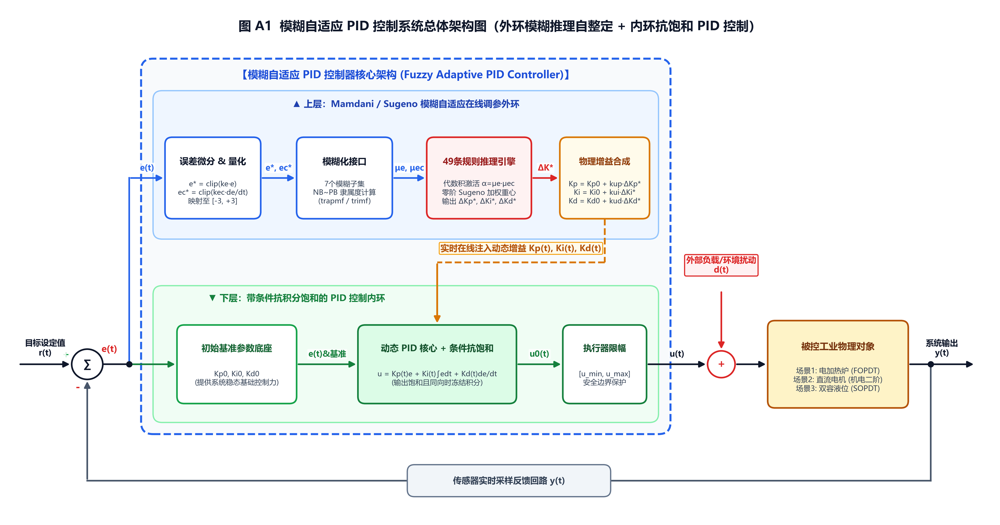
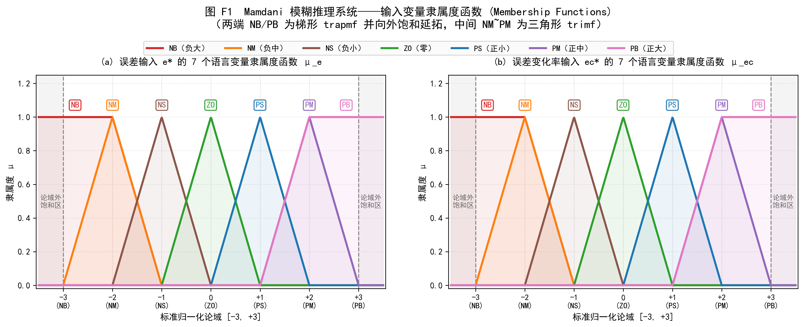
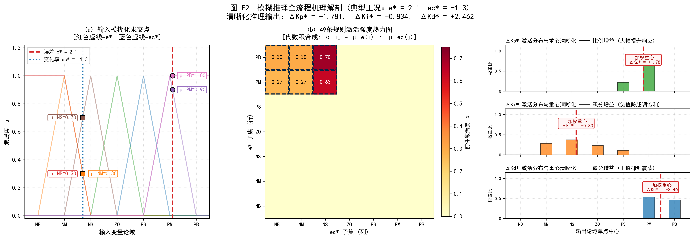
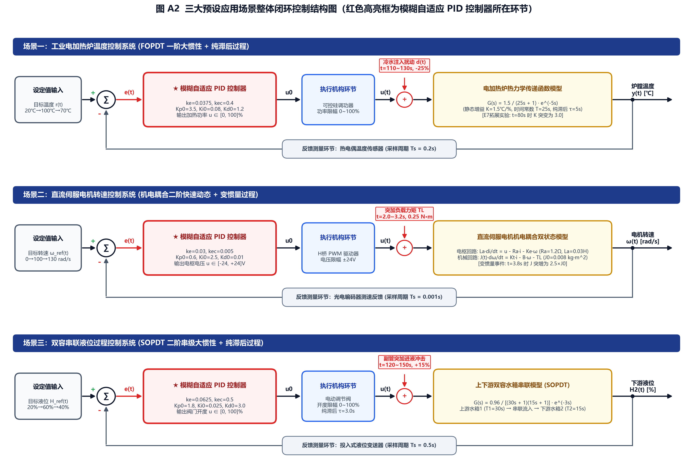
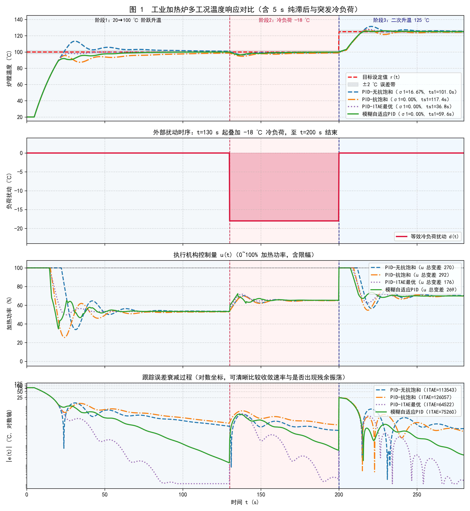
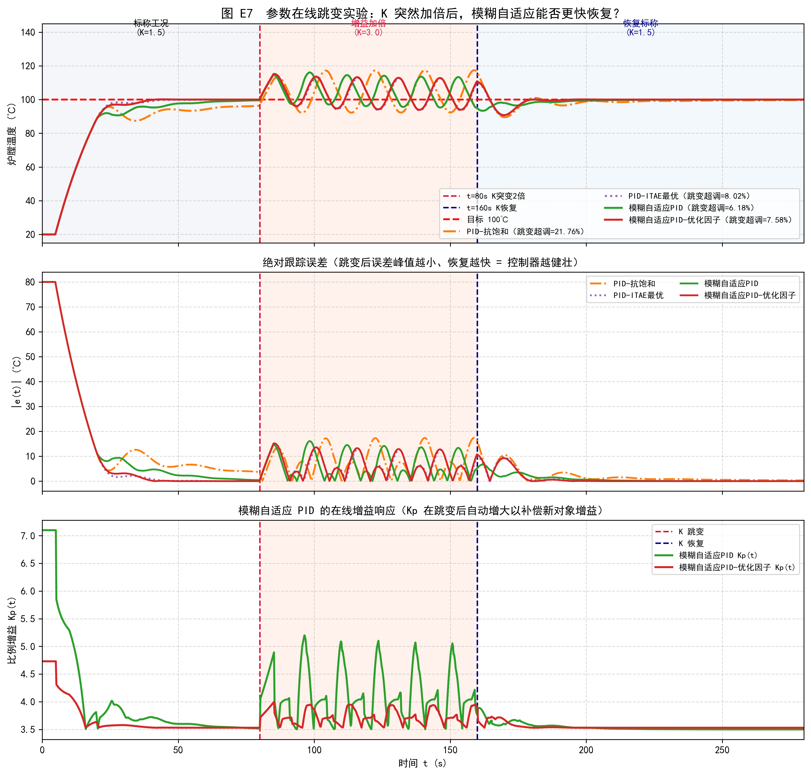
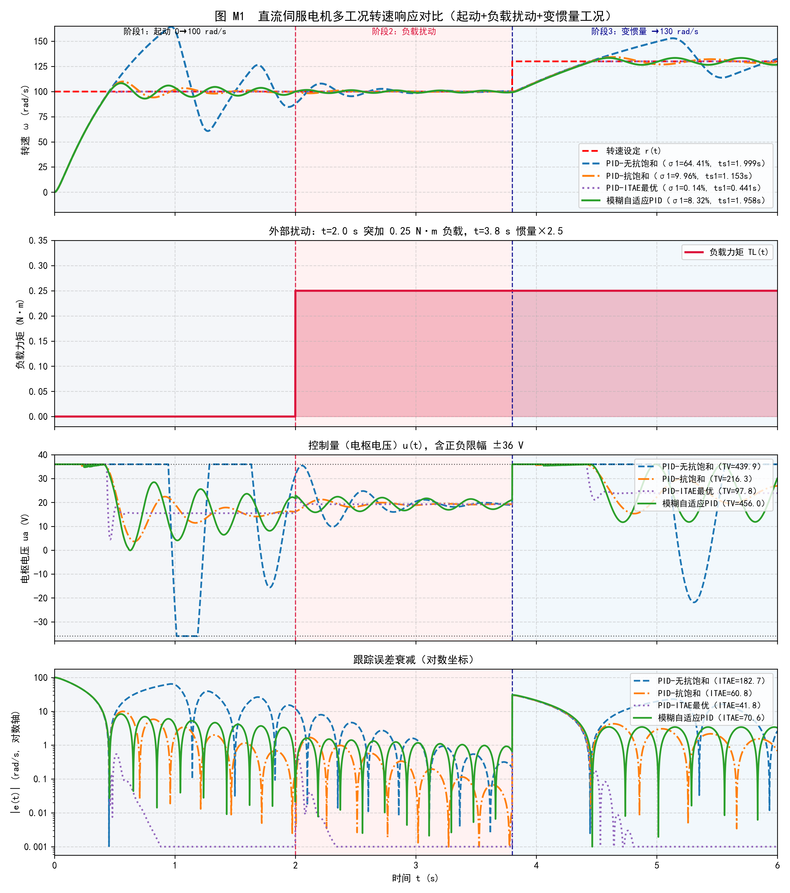
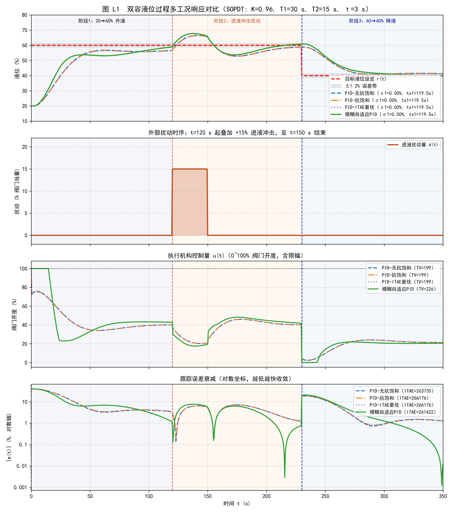
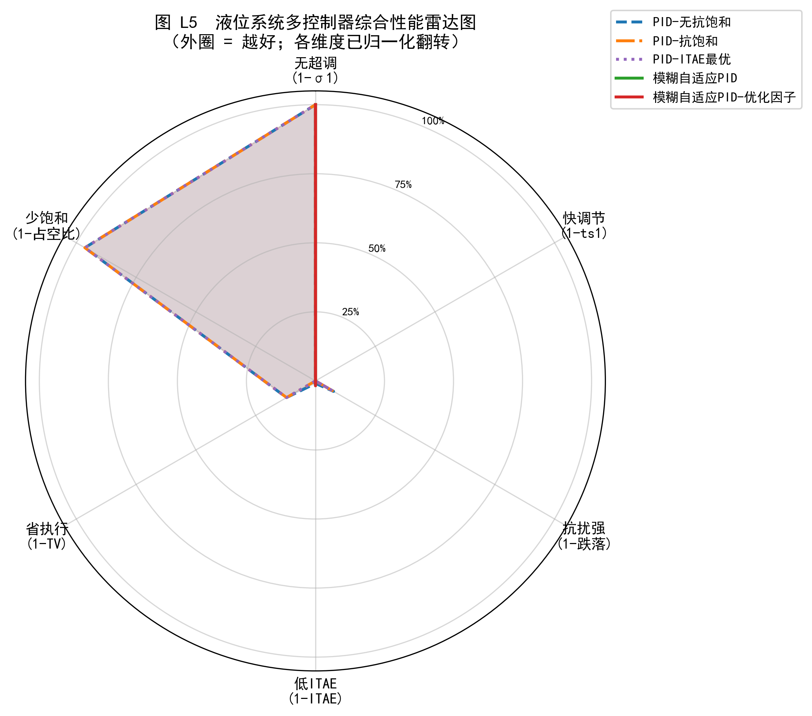

# 智能控制课程设计 · PPT 制作与答辩演讲指导书

> **文档说明**：本指导书严格按照答辩 PPT 目录大纲（**01 原理说明 → 02 架构说明 → 03 应用说明 → 04 总结**）进行编排，包含完整的数学公式、变量释义、49 条控制规则表、系统架构图、三大预设场景详细工况（场景说明、控制需求、传递函数、变化事件预设、控制参数表、整体控制回路结构图及仿真对比图）以及最终的小组成员分工表。

---

## 目录大纲 (CONTENTS)

|   章节编号   | 章节名称           | 核心内容模块                                                                                                                                                                           | 建议页码范围 |
| :----------: | :----------------- | :------------------------------------------------------------------------------------------------------------------------------------------------------------------------------------- | :-----------: |
| **01** | **原理说明** | 传统 PID 原理与瓶颈、模糊控制与自适应控制概念、模糊自适应 PID 核心原理与公式变量释义、方案横向对比                                                                                     |  第 1 ~ 6 页  |
| **02** | **架构说明** | 模糊自适应 PID 总体双环架构图、内部六大核心功能模块详解、隶属度函数、49 条三维控制规则表、推理与清晰化解剖                                                                             | 第 7 ~ 10 页 |
| **03** | **应用说明** | 三大场景整体闭环控制结构图；工业加热炉 (FOPDT)、直流伺服电机 (机电二阶)、双容串联液位 (SOPDT) 的场景说明、控制需求、传递函数、变化事件预设、控制参数表与仿真对比（含 E7 参数跳变实验） | 第 11 ~ 18 页 |
| **04** | **总　　结** | 多场景实验核心结论与工程选型准则、课程设计小组成员及分工表、致谢与答辩 Q&A                                                                                                             | 第 19 ~ 21 页 |

---

# 01 原理说明

### 第 1 页：封面（Title Slide）

* **主标题**：模糊自适应 PID 控制系统的设计与多场景全维度验证
* **副标题**：原理剖析 · 架构设计 · 多物理域场景建模与鲁棒性实测
* **汇报人**：尹健泷（及小组成员：杨嘉隆、刘思明、刘智康、郭振）

---

### 第 2 页：目录页（CONTENTS）

* **01 原理说明**：传统 PID、模糊控制、自适应控制及模糊自适应 PID 核心原理
* **02 架构说明**：外环模糊推理自整定 + 内环抗饱和 PID 双环控制系统架构
* **03 应用说明**：电加热炉、直流伺服电机、双容串联液位三大场景建模与结果对比
* **04 总　　结**：工程选型启示与小组成员分工

---

### 第 3 页：传统 PID 控制原理与工业现实瓶颈

* **页面结构**：左侧“传统 PID 数学机理”，右侧“复杂工业现场瓶颈”
* **核心内容**：
  1. **传统 PID 控制律公式**：
     $$
     u(t) = K_p e(t) + K_i \int_0^t e(\tau) d\tau + K_d \frac{de(t)}{dt}
     $$

     * **$e(t) = r(t) - y(t)$**：系统跟踪误差（设定值 $r(t)$ 减去实际输出 $y(t)$）；
     * **比例项（$K_p$）**：成比例响应当前误差，决定系统响应速度的基础驱动力；
     * **积分项（$K_i$）**：累积历史误差，用于彻底消除系统的稳态静差（余差）；
     * **微分项（$K_d$）**：感知误差变化斜率 $\frac{de(t)}{dt}$，提供超前预测与阻尼制动，抑制超调。
  2. **传统定常 PID 的三大局限**：
     * **参数固化（定常假设）**：$K_p, K_i, K_d$ 在运行全程固定不变，仅对单一线性标称工况最优；
     * **快速性与平稳性矛盾**：大误差起动需要大 $K_p$ 提速，但接近稳态时大 $K_p$ 极易引发剧烈超调；
     * **积分饱和与参数失配**：执行器受物理限幅时积分持续盲目累加（Windup）；当对象增益、惯量或滞后发生漂移突变时，固定参数极易震荡失稳。

---

### 第 4 页：基础铺垫 —— 什么是“模糊控制”与“自适应控制”？

* **页面结构**：左右双卡片对比 + 底部融合过渡
* **核心内容**：
  1. **模糊控制（Fuzzy Control）—— 人类专家经验的数学化**：
     * **核心定义**：基于模糊集合论、**不依赖被控对象精确数学模型**的智能控制方法；
     * **运作机制**：模仿人类操作员的直觉思维，将精确的测量数值转化为“负大 (NB)、零 (ZO)、正大 (PB)”等模糊语言变量，通过 `IF-THEN` 专家规则库进行逻辑推理；
     * **核心优势**：擅长处理强非线性、大滞后、机理复杂但具备丰富人工调参经验的工业过程。
  2. **自适应控制（Adaptive Control）—— 动态环境下的自我进化**：
     * **核心定义**：在系统运行过程中持续监测状态与环境变化，并**在线自动调整控制器参数或结构**的控制策略；
     * **运作机制**：在基础反馈控制内环之上构建一个“参数自整定外环”，当对象特性漂移或受外部扰动冲击时，实时修正控制器增益；
     * **核心优势**：彻底打破传统控制器“参数一经整定、终身固定不变”的僵局，使系统在变工况下始终保持优异品质。
  3. **二者的强强融合（承上启下）**：
     * 用**模糊控制**的“专家经验规则库”充当**自适应控制**的“在线调参大脑”，实时动态修正**传统 PID** 的三个增益 —— 由此构成**模糊自适应 PID 控制**！

---

### 第 5 页：模糊自适应 PID 控制原理与公式变量释义

* **页面结构**：上方核心定义与公式 + 中部完整变量释义 + 下方全工况调参哲学
* **核心内容**：
  1. **动态增益在线合成公式**：
     将熟练工程师在不同误差阶段调整 PID 的启发式经验转化为模糊推理规则，以实时误差 $e(t)$ 和误差变化率 $ec(t)$ 为输入，毫秒级在线动态计算 PID 三项增益：
     $$
     K_p(t) = K_{p0} + k_{up} \cdot \Delta K_p(e, ec), \quad K_i(t) = K_{i0} + k_{ui} \cdot \Delta K_i(e, ec), \quad K_d(t) = K_{d0} + k_{ud} \cdot \Delta K_d(e, ec)
     $$
  2. **公式核心变量逐一释义（答辩必讲）**：
     * **$K_p(t),\, K_i(t),\, K_d(t)$**：当前采样时刻 $t$ 实际输入给 PID 控制器的**实时动态增益**；
     * **$K_{p0},\, K_{i0},\, K_{d0}$**：预先整定的**初始基准 PID 参数**（提供系统基础稳态控制能力，即控制底座）；
     * **$\Delta K_p,\, \Delta K_i,\, \Delta K_d$**：模糊推理机根据实时状态 $(e, ec)$ 在线推理输出的**归一化论域修正量**（无量纲相对值，取值范围 $[-3, +3]$）；
     * **$k_{up},\, k_{ui},\, k_{ud}$**：**输出比例缩放因子（Scaling Factors）**，用于将无量纲的论域修正量 $\Delta K$ 线性放大为具有真实物理量纲的增益增量（决定自适应调节的步长与灵敏度）；
     * **$e,\, ec$**：系统当前的**实时跟踪误差** $e(t) = r(t) - y(t)$ 与**误差变化率** $ec(t) = \frac{de(t)}{dt}$。
  3. **全工况自适应整定黄金法则**：
     * **大误差阶段（$|e|$ 大，起动或大扰动初期）**：大幅**增大 $K_p$** 全力提速；**削弱/清零 $K_i$** 杜绝积分饱和积聚；取适中偏小 $K_d$ 避免微分饱和；
     * **中误差且快速逼近阶段（$|e|$ 中，$|ec|$ 大）**：适度**下调 $K_p$** 防止冲过头；**大幅增大 $K_d$** 施加提前阻尼刹车；适度恢复 $K_i$；
     * **小误差稳态阶段（$|e|$ 小，接近目标）**：**增大 $K_i$** 快速消除稳态余差；保持较大 $K_d$ 抑制末端微小震荡。

---

### 第 6 页：传统固定 PID 与模糊自适应 PID 核心维度对比

* **展示形式**：全维度对比表格

| 评估维度                  | 传统固定 PID (Conventional PID)                  | 模糊自适应 PID (Fuzzy Adaptive PID)                            |
| :------------------------ | :----------------------------------------------- | :------------------------------------------------------------- |
| **参数特性**        | 运行全过程$K_p, K_i, K_d$ 恒定不变             | 随系统状态$(e, ec)$ 毫秒级在线连续动态自整定                 |
| **先验模型依赖**    | 极高（严重依赖单一工作点线性化模型的精度）       | 低（融合基础数学模型与人类专家启发式规则）                     |
| **时变/突变鲁棒性** | 差（对象增益或惯量突变时极易大幅超调或震荡）     | **极强（感知异常斜率后主动降增益，具备在线自救能力）**   |
| **大滞后与防超调**  | 难以兼顾快速升温与零超调，反向阶跃易产生二次过冲 | **动态削弱大误差期积分、增强逼近段阻尼，有效实现零超调** |
| **计算开销**        | 极低（仅需数次加减乘除）                         | 中等偏低（需执行模糊化、$7\times 7$ 规则矩阵运算及加权重心） |
| **典型适用场景**    | 线性、定常、工作点固定、扰动微弱的基础回路       | **强时滞、大惯性、变负荷、参数时变的复杂工业过程**       |

---

# 02 架构说明

### 第 7 页：模糊自适应 PID 控制器总体架构图（双环结构）

* **核心配图**：直接插入高清架构图 [`python/A1_fuzzy_pid_overall_architecture.png`](file:///d:/AAAA学生工作/课程-智能控制/python/A1_fuzzy_pid_overall_architecture.png)

* **架构核心层次解析（外环自整定 + 内环抗饱和控制）**：
  1. **上层 —— Mamdani / Sugeno 模糊自适应在线调参外环**：
     * **① 误差微分与量化模块**：采集实时误差 $e(t)$ 并求取差分导数 $ec(t)$，乘以输入量化因子 $k_e, k_{ec}$ 并截断映射至标准论域 $[-3, +3]$：
       $$
       e^* = \text{clip}(k_e \cdot e(t),\,-3,\,+3), \qquad ec^* = \text{clip}(k_{ec} \cdot ec(t),\,-3,\,+3)
       $$
     * **② 模糊化接口（Fuzzification）**：计算 $e^*$ 与 $ec^*$ 在 7 个模糊子集（NB, NM, NS, ZO, PS, PM, PB）上的隶属度向量 $\boldsymbol{\mu}_e, \boldsymbol{\mu}_{ec} \in [0, 1]^7$；
     * **③ 49 条规则推理引擎（Inference & Defuzzification）**：采用代数积 T-范数计算前件激活矩阵 $\alpha_{ij} = \mu_e(i)\cdot\mu_{ec}(j)$，匹配 $7\times 7$ 规则表并由零阶 Sugeno 加权重心法解算出 $\Delta K_p^*, \Delta K_i^*, \Delta K_d^*$；
     * **④ 物理增益动态合成模块**：将论域修正量乘上比例缩放因子 $k_{up}, k_{ui}, k_{ud}$，与基准参数底座叠加并做非负安全限幅，实时向下注入内环。
  2. **下层 —— 带条件抗积分饱和的动态 PID 控制内环**：
     * **⑤ 初始基准参数底座**：提供稳态工作点所需的 $K_{p0}, K_{i0}, K_{d0}$；
     * **⑥ 动态 PID 核心 + 条件积分抗饱和（Conditional Integration）**：接收上层实时注入的 $K_p(t), K_i(t), K_d(t)$，当执行器输出达到物理限幅 $[u_{\min}, u_{\max}]$ 且误差继续同向恶化时自动冻结积分累加，从架构底层根除积分饱和。

---

### 第 8 页：架构模块一 —— 模糊化接口与隶属度函数设计

* **核心配图**：[`python/F1_fuzzy_membership_functions.png`](file:///d:/AAAA学生工作/课程-智能控制/python/F1_fuzzy_membership_functions.png)

* **架构设计细节**：
  1. **标准论域与语言变量**：输入 $e^*, ec^*$ 与输出 $\Delta K^*$ 统一划分在 $[-3, +3]$ 论域上，定义 7 个语言变量，对应论域中心值为 $\{-3, -2, -1, 0, +1, +2, +3\}$；
  2. **混合隶属度函数选型**：
     * **中间 5 个子集（NM, NS, ZO, PS, PM）**：采用灵敏度高、计算简洁的**对称三角形隶属度函数 (`trimf`)**，确保小误差段调节细腻平滑；
     * **两端极值子集（NB, PB）**：采用**饱和平顶梯形隶属度函数 (`trapmf`)**，并在论域外延保持恒等于 $1.0$ 的饱和特性；
  3. **针对极端工况的斜坡重叠优化**：
     * 图中可见 NB 与 NM 在 $[-2, -1]$、PB 与 PM 在 $[+1, +2]$ 斜坡重合，这是专门设计的**“极端规则前置介入机制”**：当归一化误差刚越过 $\pm 1$ 时，极值规则（NB/PB）便提前激活发力，在面对大阶跃或突发强扰动时提供更果断的回拉响应。

---

### 第 9 页：架构模块二 —— 49 条专家模糊规则库（完整控制表）

* **展示形式**：三张 $7 \times 7$ 核心控制规则矩阵表（源自唯一真值配置 `shared/fuzzy_config.json`，表中整数代表输出模糊子集中心：$-3=\text{NB}, -2=\text{NM}, -1=\text{NS}, 0=\text{ZO}, +1=\text{PS}, +2=\text{PM}, +3=\text{PB}$）

#### （1）比例增益修正规则表 $\Delta K_p^*$（行：$e^*$，列：$ec^*$）

| $e^* \backslash ec^*$ | **NB (-3)** | **NM (-2)** | **NS (-1)** | **ZO (0)** | **PS (+1)** | **PM (+2)** | **PB (+3)** |
| :---------------------: | :---------------: | :---------------: | :---------------: | :--------------: | :---------------: | :---------------: | :---------------: |
|    **NB (-3)**    |      +3 (PB)      |      +3 (PB)      |      +3 (PB)      |     +3 (PB)     |      +2 (PM)      |      +2 (PM)      |      +2 (PM)      |
|    **NM (-2)**    |      +3 (PB)      |      +3 (PB)      |      +3 (PB)      |     +2 (PM)     |      +2 (PM)      |      +1 (PS)      |      +1 (PS)      |
|    **NS (-1)**    |      +2 (PM)      |      +2 (PM)      |      +2 (PM)      |     +1 (PS)     |      0 (ZO)      |      0 (ZO)      |      0 (ZO)      |
|    **ZO (0)**    |      +1 (PS)      |      +1 (PS)      |      0 (ZO)      |      0 (ZO)      |      0 (ZO)      |      +1 (PS)      |      +1 (PS)      |
|    **PS (+1)**    |      0 (ZO)      |      0 (ZO)      |      0 (ZO)      |     +1 (PS)     |      +2 (PM)      |      +2 (PM)      |      +2 (PM)      |
|    **PM (+2)**    |      +1 (PS)      |      +1 (PS)      |      +2 (PM)      |     +2 (PM)     |      +3 (PB)      |      +3 (PB)      |      +3 (PB)      |
|    **PB (+3)**    |      +2 (PM)      |      +2 (PM)      |      +2 (PM)      |     +3 (PB)     |      +3 (PB)      |      +3 (PB)      |      +3 (PB)      |

#### （2）积分增益修正规则表 $\Delta K_i^*$（行：$e^*$，列：$ec^*$）

| $e^* \backslash ec^*$ | **NB (-3)** | **NM (-2)** | **NS (-1)** | **ZO (0)** | **PS (+1)** | **PM (+2)** | **PB (+3)** |
| :---------------------: | :---------------: | :---------------: | :---------------: | :--------------: | :---------------: | :---------------: | :---------------: |
|    **NB (-3)**    |      -3 (NB)      |      -3 (NB)      |      -3 (NB)      |     -3 (NB)     |      -2 (NM)      |      -1 (NS)      |      0 (ZO)      |
|    **NM (-2)**    |      -3 (NB)      |      -2 (NM)      |      -2 (NM)      |     -2 (NM)     |      -1 (NS)      |      0 (ZO)      |      +1 (PS)      |
|    **NS (-1)**    |      -2 (NM)      |      -1 (NS)      |      0 (ZO)      |     +1 (PS)     |      +2 (PM)      |      +2 (PM)      |      +2 (PM)      |
|    **ZO (0)**    |      -1 (NS)      |      0 (ZO)      |      +2 (PM)      |     +3 (PB)     |      +2 (PM)      |      0 (ZO)      |      -1 (NS)      |
|    **PS (+1)**    |      +2 (PM)      |      +2 (PM)      |      +2 (PM)      |     +1 (PS)     |      0 (ZO)      |      -1 (NS)      |      -2 (NM)      |
|    **PM (+2)**    |      +1 (PS)      |      0 (ZO)      |      -1 (NS)      |     -2 (NM)     |      -2 (NM)      |      -2 (NM)      |      -3 (NB)      |
|    **PB (+3)**    |      0 (ZO)      |      -1 (NS)      |      -2 (NM)      |     -3 (NB)     |      -3 (NB)      |      -3 (NB)      |      -3 (NB)      |

#### （3）微分增益修正规则表 $\Delta K_d^*$（行：$e^*$，列：$ec^*$）

| $e^* \backslash ec^*$ | **NB (-3)** | **NM (-2)** | **NS (-1)** | **ZO (0)** | **PS (+1)** | **PM (+2)** | **PB (+3)** |
| :---------------------: | :---------------: | :---------------: | :---------------: | :--------------: | :---------------: | :---------------: | :---------------: |
|    **NB (-3)**    |      0 (ZO)      |      0 (ZO)      |      +1 (PS)      |     +1 (PS)     |      +2 (PM)      |      +3 (PB)      |      +3 (PB)      |
|    **NM (-2)**    |      0 (ZO)      |      +1 (PS)      |      +1 (PS)      |     +2 (PM)     |      +2 (PM)      |      +3 (PB)      |      +3 (PB)      |
|    **NS (-1)**    |      +1 (PS)      |      +1 (PS)      |      +2 (PM)      |     +2 (PM)     |      +3 (PB)      |      +3 (PB)      |      +2 (PM)      |
|    **ZO (0)**    |      +2 (PM)      |      +2 (PM)      |      +3 (PB)      |     +3 (PB)     |      +3 (PB)      |      +2 (PM)      |      +2 (PM)      |
|    **PS (+1)**    |      +2 (PM)      |      +3 (PB)      |      +3 (PB)      |     +2 (PM)     |      +2 (PM)      |      +1 (PS)      |      +1 (PS)      |
|    **PM (+2)**    |      +3 (PB)      |      +3 (PB)      |      +2 (PM)      |     +2 (PM)     |      +1 (PS)      |      +1 (PS)      |      0 (ZO)      |
|    **PB (+3)**    |      +3 (PB)      |      +3 (PB)      |      +2 (PM)      |     +1 (PS)     |      +1 (PS)      |      0 (ZO)      |      0 (ZO)      |

---

### 第 10 页：架构模块三 —— 模糊推理全链条解剖与三维决策曲面

* **核心配图 1**：[`python/F2_fuzzy_inference_anatomy.png`](file:///d:/AAAA学生工作/课程-智能控制/python/F2_fuzzy_inference_anatomy.png)
* **核心配图 2**：[`python/4_fuzzy_decision_surfaces_3d.png`](file:///d:/AAAA学生工作/课程-智能控制/python/4_fuzzy_decision_surfaces_3d.png)

* **数学推理机制说明**：
  1. **前件合成（代数积 T-范数）**：第 $(i,j)$ 条规则的激活强度为 $\alpha_{ij} = \mu_e(i) \cdot \mu_{ec}(j)$（对应图 F2b 中高亮的 6 个激活单元格）；
  2. **加权重心清晰化（Weighted Average Defuzzification）**：
     $$
     \Delta K_p^* = \frac{\sum_{i=1}^7\sum_{j=1}^7 \alpha_{ij}\cdot R_{kp}(i,j)}{\sum_{i=1}^7\sum_{j=1}^7 \alpha_{ij}}, \quad \Delta K_i^* = \frac{\sum \alpha_{ij}\cdot R_{ki}(i,j)}{\sum \alpha_{ij}}, \quad \Delta K_d^* = \frac{\sum \alpha_{ij}\cdot R_{kd}(i,j)}{\sum \alpha_{ij}}
     $$
  3. **连续非线性映射曲面**：在整个 $[-3, +3]^2$ 论域上，模糊推理机构成了三张平滑无跳变的非线性增益曲面（见图 `4_fuzzy_decision_surfaces_3d.png`），确保参数调整过程无高频抖振。

---

# 03 应用说明（三大工业场景详述与对比）

### 第 11 页：三大预设应用场景整体闭环控制结构总览

* **核心配图**：直接插入高清回路结构图 [`python/A2_scenarios_control_loops.png`](file:///d:/AAAA学生工作/课程-智能控制/python/A2_scenarios_control_loops.png)

* **结构图要义说明（体现控制器所在环节与整体回路架构）**：
  * **前向控制通道**：由 **设定值发生器 $r(t)$ → 误差求和比较节点 $\sum$ → 【★ 模糊自适应 PID 控制器（核心控制大脑）】 → 执行机构物理限幅环节 → 外部扰动叠加点 $d(t)$ → 被控工业物理对象 $G(s)$** 串联构成；
  * **反馈测量通道**：由各场景专属传感器（热电偶 / 光电编码器 / 投入式液位变送器）按设定采样周期 $T_s$ 实时采集输出 $y(t)$，回传至比较节点形成闭环；
  * **5 组标准对照控制器设计**：
    1. `PID-无抗饱和`：朴素固定 PID，复现积分饱和现象；
    2. `PID-抗饱和`：固定 PID + 条件抗积分饱和（基础工程对照）；
    3. `PID-ITAE最优`：经 Nelder-Mead 数值寻优得到的**最强固定参数 PID**；
    4. `模糊自适应PID`：采用经验默认缩放因子的模糊自适应控制器；
    5. `模糊自适应PID-优化因子`：经同等算力寻优缩放因子后的**最强模糊自适应控制器**。

---

### 第 12 页：场景一（工业电加热炉）—— 场景建模、需求、事件预设与控制表

* **1. 场景物理说明**：
  工业电阻加热炉是典型的热工过程控制对象。电热丝通电发热，通过炉壁热传导与空气对流加热炉膛，具有显著的**大热容惯性**与**热传导纯滞后**特征，且加热功率受单向物理限幅（只可加热 $0\sim 100\%$，不可主动制冷，冷却完全依赖自然散热）。
* **2. 控制需求**：

  * **快速升温**：从室温 $20^\circ\text{C}$ 阶跃升至 $100^\circ\text{C}$ 时，上升时间短且**克服单向限幅导致的积分饱和超调**；
  * **强抗扰恢复**：在冷水注入或炉门开启导致热量骤降时，温度跌落小、恢复快；
  * **反向降温对称性**：从 $100^\circ\text{C}$ 降至 $70^\circ\text{C}$ 时平滑过渡，减小下冲超调。
* **3. 传递函数与微分方程模型（FOPDT 一阶惯性加纯滞后）**：

  $$
  G_1(s) = \frac{Y(s)}{U(s)} = \frac{K}{T s + 1} e^{-\tau s} = \frac{1.5}{25 s + 1} e^{-5s}
  $$

  对应时域微分方程（环境基准温度 $y_0 = 20^\circ\text{C}$）：
  $$
  25 \frac{dy(t)}{dt} + \big(y(t) - 20\big) = 1.5 \cdot u(t - 5.0) + d(t), \qquad u(t) \in [0,\, 100]\%
  $$
* **4. 变化事件预设（仿真总时长 $280\,\text{s}$，采样步长 $dt = 0.2\,\text{s}$）**：

|                                                                                   时间节点                                                                                   | 事件类型                                               | 预设工况变化详情                                                                                                        | 考核目的                                   |
| :--------------------------------------------------------------------------------------------------------------------------------------------------------------------------: | :----------------------------------------------------- | :---------------------------------------------------------------------------------------------------------------------- | :----------------------------------------- |
|                                                                       **$t = 0.0\,\text{s}$**                                                                       | 设定值大阶跃升温                                       | 目标温度$r(t)$ 由初始室温 **$20^\circ\text{C}$ 阶跃升至 $100^\circ\text{C}$**（幅度 $+80^\circ\text{C}$） | 考核大范围起动速度与抗积分饱和防超调能力   |
|                                                                 **$t = 110.0 \sim 130.0\,\text{s}$**                                                                 | 外部强冷扰动注入                                       | 持续$20\,\text{s}$ 注入冷水冷却扰动，等效功率冲击 **$d(t) = -25.0\%$**                                        | 考核稳态抗强负载干扰与动态恢复能力         |
|                                                                      **$t = 190.0\,\text{s}$**                                                                      | 设定值反向阶跃降温                                     | 目标温度$r(t)$ 由 **$100^\circ\text{C}$ 阶跃降至 $70^\circ\text{C}$**（幅度 $-30^\circ\text{C}$）         | 考核非对称自然冷却下的反向跟踪与防下冲能力 |
| **$t = 80.0 \sim 160.0\,\text{s}$** | **【E7 拓展】对象参数跳变** | 稳态下炉体静态增益 **$K$ 由 $1.5$ 瞬间突变为 $3.0$（翻倍）**，控制器参数不重调 | **考核对象模型严重失配时模糊控制的在线自救能力** |                                                                                                                         |                                            |

* **5. 场景一控制器参数配置表**：

| 控制器名称                       | 基准比例$K_{p0}$ | 基准积分$K_{i0}$ | 基准微分$K_{d0}$ | 误差量化$k_e$ | 变化率量化$k_{ec}$ | 比例缩放$k_{up}$ | 积分缩放$k_{ui}$ | 微分缩放$k_{ud}$ |
| :------------------------------- | :----------------: | :----------------: | :----------------: | :-------------: | :------------------: | :----------------: | :----------------: | :----------------: |
| **PID-无抗饱和 / 抗饱和**  |       3.500       |       0.080       |       1.200       |       —       |          —          |         —         |         —         |         —         |
| **PID-ITAE最优**           |       4.864       |       0.200       |       8.211       |       —       |          —          |         —         |         —         |         —         |
| **模糊自适应PID（默认）**  |       3.500       |       0.080       |       1.200       |     0.0375     |        0.400        |       1.200       |       0.035       |       2.500       |
| **模糊自适应PID-优化因子** |       4.864       |       0.200       |       8.211       |     0.0375     |        0.400        |       1.459       |       0.008       |       0.569       |

---

### 第 13 页：场景一（工业电加热炉）—— 标称仿真结果与参数自整定轨迹

* **核心配图 1**：[`python/1_temperature_power_disturbance_response.png`](file:///d:/AAAA学生工作/课程-智能控制/python/1_temperature_power_disturbance_response.png)
* **核心配图 2**：[`python/3_fuzzy_parameter_adaptation_trajectories.png`](file:///d:/AAAA学生工作/课程-智能控制/python/3_fuzzy_parameter_adaptation_trajectories.png)

* **标称工况实测性能指标对比表**：

| 控制器方案                       | 上升时间$t_r/\text{s}$ | 升温超调$\sigma_1/\%$ | 调节时间$t_{s1}/\text{s}$ | 扰动跌落$/^\circ\text{C}$ | 扰动恢复$/\text{s}$ | 降温超调$\sigma_2/\%$ |    全程 ITAE    | 控制量总变差 TV |
| :------------------------------- | :----------------------: | :---------------------: | :-------------------------: | :-------------------------: | :-------------------: | :---------------------: | :--------------: | :-------------: |
| **PID-无抗饱和**           |          15.00          |         16.67%         |            101.0            |            3.50            |         15.0         |         25.57%         |     113,543     |       270       |
| **PID-抗饱和**             |          15.20          |     **0.00%**     |            117.4            |            5.25            |         48.2         |          9.92%          |     126,057     |       292       |
| **PID-ITAE最优**           |          15.20          |     **0.00%**     |            36.8            |            3.78            |         13.2         |         11.65%         |      64,522      |       176       |
| **模糊自适应PID（默认）**  |          24.40          |     **0.00%**     |            59.6            |       **3.53**       |         21.4         |     **4.32%**     |      75,260      |       269       |
| **模糊自适应PID-优化因子** |          15.40          |          0.16%          |       **35.8**       |            3.70            |    **12.8**    |         11.26%         | **63,585** |  **174**  |

* **结果深度解读**：
  * **同基准对比（`模糊默认` vs `PID-抗饱和`）**：在相同初始参数 $(3.5, 0.08, 1.2)$ 下，模糊自适应将调节时间从 $117.4\,\text{s}$ 缩短至 $59.6\,\text{s}$（**提速 49.2%**），降温超调从 $9.92\%$ 压低至 $4.32\%$（**降低 56.5%**），全程 ITAE 改善 **40.3%**！
  * **极限对比（`模糊优化因子` vs `PID-ITAE最优`）**：在标称线性工况下，固定最优 PID 已接近理论极限，模糊优化因子在此基础上进一步将 ITAE 压低至 $63,585$（改善 $1.5\%$）。

---

### 第 14 页：场景一高潮（E7 参数在线跳变实验）—— 自适应核心价值实证

* **核心配图**：[`results/figures/E7_param_jump.png`](file:///d:/AAAA学生工作/课程-智能控制/results/figures/E7_param_jump.png)

* **实验工况与结果对比表（$t=80\,\text{s}$ 时对象增益 $K$ 由 $1.5$ 突变为 $3.0$，控制器参数冻结）**：

| 控制器方案                       | 跳变段超调量$/\%$ |  最大温度偏差$/^\circ\text{C}$  | 恢复调节时间$/\text{s}$ |    全程 ITAE    | 鲁棒性评价                                                          |
| :------------------------------- | :-----------------: | :-------------------------------: | :-----------------------: | :--------------: | :------------------------------------------------------------------ |
| **PID-抗饱和**             |  **21.76%**  |      $17.41^\circ\text{C}$      |           79.8           |     146,340     | 固定增益相对失配，产生大幅过冲与持续震荡                            |
| **PID-ITAE最优**           |        8.02%        |      $15.19^\circ\text{C}$      |           79.8           | **88,782** | 标称最优参数在$K$ 翻倍后变得过于激进，出现明显超调                |
| **模糊自适应PID（默认）**  |   **6.18%**   |      $16.09^\circ\text{C}$      |           79.8           |      97,029      | **★ 跳变超调最低！比抗饱和PID降低 71.6%，比最优PID降低 23%** |
| **模糊自适应PID-优化因子** |        7.58%        | **$15.17^\circ\text{C}$** |           79.8           |      88,965      | 兼顾低超调与最小最大偏差                                            |

* **核心结论**：当被控对象发生未知突变时，模糊推理机敏锐捕捉到误差反向激增，**在线紧急下调 $K_p$、增大 $K_d$ 制动**（见图中最下方增益轨迹），实现了固定 PID 无法做到的**“在线自救”**。

---

### 第 15 页：场景二（直流伺服电机）—— 场景建模、需求、事件预设与控制表

* **1. 场景物理说明**：
  永磁直流伺服电机是工业机器人、数控机床的核心执行部件，属于典型的**机电耦合二阶快速动态系统**。输入为 H 桥驱动器的电枢电压 $u(t) \in [-24, +24]\,\text{V}$，输出为转子机械角速度 $\omega(t)$，内部存在电枢电感电流 $i_a(t)$ 与反电动势 $K_e \omega(t)$ 的强耦合。
* **2. 控制需求**：

  * **毫秒级无超调起动**：在 $0 \to 100\,\text{rad/s}$ 高速起动时，克服电枢大电流冲击，实现零超调快速入位；
  * **强抗负载力矩冲击**：切削或抓取突加负载力矩 $T_L$ 时，转速跌落极小并瞬时恢复；
  * **变转动惯量鲁棒性**：机械臂伸展或挂载重物导致转动惯量 $J$ 成倍剧增时，维持高动态跟踪且不发生震荡。
* **3. 状态空间微分方程与传递函数模型**：

  $$
  \begin{cases}
  \text{电枢电磁回路：} & L_a \dfrac{di_a(t)}{dt} = u(t) - R_a i_a(t) - K_e \omega(t) \\[6pt]
  \text{转子机械回路：} & J(t) \dfrac{d\omega(t)}{dt} = K_t i_a(t) - B \omega(t) - T_L(t)
  \end{cases}
  $$

  消去电枢电流 $i_a$ 后的二阶传递函数：
  $$
  G_2(s) = \frac{\Omega(s)}{U(s)} = \frac{K_t}{(L_a s + R_a)(J s + B) + K_t K_e}
  $$

  * **物理参数设定**：电枢电阻 $R_a = 1.2\,\Omega$，电枢电感 $L_a = 0.03\,\text{H}$，转矩系数 $K_t = 0.08\,\text{N}\cdot\text{m/A}$，反电势系数 $K_e = 0.08\,\text{V}\cdot\text{s/rad}$，粘性摩擦系数 $B = 0.002\,\text{N}\cdot\text{m}\cdot\text{s/rad}$，标称转动惯量 $J_0 = 0.008\,\text{kg}\cdot\text{m}^2$。
* **4. 变化事件预设（仿真总时长 $6.0\,\text{s}$，采样步长 $dt = 0.001\,\text{s}$）**：

|                                                                                                       时间节点                                                                                                       | 事件类型                                                  | 预设工况变化详情                                                                       | 考核目的                               |
| :------------------------------------------------------------------------------------------------------------------------------------------------------------------------------------------------------------------: | :-------------------------------------------------------- | :------------------------------------------------------------------------------------- | :------------------------------------- |
|                                                                                           **$t = 0.0\,\text{s}$**                                                                                           | 空载高速阶跃起动                                          | 目标转速$\omega_{\text{ref}}$ 由 **$0$ 阶跃升至 $100\,\text{rad/s}$**      | 考核快速起动响应与 ±24V 电压饱和抑制  |
|                                                                                       **$t = 2.0 \sim 3.2\,\text{s}$**                                                                                       | 突加恒定负载力矩                                          | 持续$1.2\,\text{s}$ 突加外部负载转矩 **$T_L = 0.25\,\text{N}\cdot\text{m}$** | 考核突加机械负载下的转速跌落与恢复速度 |
| **$t = 3.8\,\text{s}$** | **惯量突变 + 二次提速** | 转子惯量 **$J$ 瞬间突增为 $2.5 \times J_0$（$0.02\,\text{kg}\cdot\text{m}^2$）**，同时目标转速阶跃升至 **$130\,\text{rad/s}$** | **考核对象机械惯量剧增 2.5 倍下的自适应跟踪鲁棒性** |                                                                                        |                                        |

* **5. 场景二控制器参数配置表**：

| 控制器名称                       | 基准比例$K_{p0}$ | 基准积分$K_{i0}$ | 基准微分$K_{d0}$ | 误差量化$k_e$ | 变化率量化$k_{ec}$ | 比例缩放$k_{up}$ | 积分缩放$k_{ui}$ | 微分缩放$k_{ud}$ |
| :------------------------------- | :----------------: | :----------------: | :----------------: | :-------------: | :------------------: | :----------------: | :----------------: | :----------------: |
| **PID-无抗饱和 / 抗饱和**  |       0.600       |       2.500       |       0.010       |       —       |          —          |         —         |         —         |         —         |
| **PID-ITAE最优**           |       1.981       |       4.829       |       0.044       |       —       |          —          |         —         |         —         |         —         |
| **模糊自适应PID（默认）**  |       0.600       |       2.500       |       0.010       |      0.030      |        0.005        |       0.350       |       1.200       |       0.008       |
| **模糊自适应PID-优化因子** |       1.981       |       4.829       |       0.044       |      0.030      |        0.005        |       0.140       |       0.155       |       0.021       |

---

### 第 16 页：场景二（直流伺服电机）—— 仿真结果与蒙特卡洛鲁棒性对比

* **核心配图 1**：[`python/M1_motor_response_main.png`](file:///d:/AAAA学生工作/课程-智能控制/python/M1_motor_response_main.png)
* **核心配图 2**：[`python/M3_motor_gain_adaptation.png`](file:///d:/AAAA学生工作/课程-智能控制/python/M3_motor_gain_adaptation.png)
* **核心配图 3**：[`python/M4_motor_mc_boxplot.png`](file:///d:/AAAA学生工作/课程-智能控制/python/M4_motor_mc_boxplot.png)

* **直流伺服电机多工况闭环性能指标对比表**：

| 控制器方案                       | 起动上升$t_r/\text{s}$ | 起动超调$\sigma_1/\%$ | 起动调节$t_{s1}/\text{s}$ | 负载跌落$/(\text{rad/s})$ | 变惯量超调$\sigma_2/\%$ | 变惯量调节$t_{s2}/\text{s}$ |   全程 ITAE   | 电压总变差 TV | 饱和占比$/\%$ |
| :------------------------------- | :----------------------: | :---------------------: | :-------------------------: | :-------------------------: | :-----------------------: | :---------------------------: | :------------: | :------------: | :-------------: |
| **PID-无抗饱和**           |          0.342          |         64.41%         |            1.999            |           11.956           |          77.21%          |             2.200             |     182.7     |     439.9     |      53.2%      |
| **PID-抗饱和**             |          0.344          |          9.96%          |            1.153            |            1.682            |          14.28%          |             2.200             |      60.8      |     216.3     |      6.9%      |
| **PID-ITAE最优**           |          0.342          |          0.14%          |       **0.441**       |       **0.383**       |      **0.60%**      |        **0.635**        | **41.8** |      97.8      |      17.5%      |
| **模糊自适应PID（默认）**  |          0.345          |          8.32%          |            1.958            |            1.615            |          11.28%          |             2.200             |      70.6      |     456.0     |      8.2%      |
| **模糊自适应PID-优化因子** |          0.342          |     **0.00%**     |            0.443            |            0.611            |           0.68%           |             0.640             |      41.9      | **84.0** | **17.0%** |

* **结果深度解读**：
  * **同基准对比（`模糊默认` vs `PID-抗饱和`）**：起动超调由 $9.96\%$ 降至 $8.32\%$，变惯量提速超调由 $14.28\%$ 降至 $11.28\%$（**相对降低 21%**）；
  * **极限对比（`模糊优化因子` vs `PID-ITAE最优`）**：实现了 **$0.00\%$ 绝对零超调起动**（完全消除了固定最优 PID 残余的 $0.14\%$ 超调），且控制电压总变差 TV 从 $97.8$ 降至 **$84.0$（降低 14.1%）**，驱动器输出更加平滑省电。

---

### 第 17 页：场景三（双容串联液位过程）—— 场景建模、需求、事件预设与控制表

* **1. 场景物理说明**：
  化工与水处理领域的**上下游双容水箱串联液位过程**。电动调节阀控制进水流量首先注入**上游水箱 1**，再经底部连通管道流入**下游水箱 2**。两个一阶容积惯性环节串联叠加管道传输纯滞后，使得系统呈现典型的**二阶过阻尼大滞后**特征，相角裕度极低，常规积分控制极易引起慢速大幅波动。
* **2. 控制需求**：

  * **平稳大范围升液**：从 $20\%$ 升至 $60\%$ 过程中克服双水箱容积迟滞，避免溢流；
  * **抑制副管进液冲击**：当副管突加未知进液流量时，快速排泄多余液位；
  * **消除反向降液二次超调**：在 $60\% \to 40\%$ 降液阶跃时，克服上游水箱存水滞后导致的“过放现象”，实现零下冲超调。
* **3. 传递函数与串联状态方程模型（SOPDT 二阶惯性加纯滞后）**：

  $$
  G_3(s) = \frac{H_2(s)}{U(s)} = \frac{K}{(T_1 s + 1)(T_2 s + 1)} e^{-\tau s} = \frac{0.96}{(30 s + 1)(15 s + 1)} e^{-3s}
  $$

  对应双容水箱串联微分方程（初始平衡液位 $y_0 = 20\%$）：

  $$
  \begin{cases}
  \text{上游水箱 1：} & T_1 \dfrac{dx_1(t)}{dt} + x_1(t) = K \cdot u(t - \tau), \qquad T_1 = 30.0\,\text{s} \\[6pt]
  \text{下游水箱 2：} & T_2 \dfrac{dx_2(t)}{dt} + x_2(t) = x_1(t) + d(t), \qquad T_2 = 15.0\,\text{s},\;\; H_2(t) = y_0 + x_2(t)
  \end{cases}
  $$
* **4. 变化事件预设（仿真总时长 $350\,\text{s}$，采样步长 $dt = 0.5\,\text{s}$）**：

|                   时间节点                   | 事件类型                     | 预设工况变化详情                                                                         | 考核目的                                                     |
| :------------------------------------------: | :--------------------------- | :--------------------------------------------------------------------------------------- | :----------------------------------------------------------- |
|       **$t = 0.0\,\text{s}$**       | 设定值阶跃升液               | 目标液位$H_{\text{ref}}$ 由初始 **$20\%$ 阶跃升至 $60\%$**（幅度 $+40\%$） | 考核二阶大滞后容积过程的升液响应与稳态精度                   |
| **$t = 120.0 \sim 150.0\,\text{s}$** | 副管进液流量冲击             | 下游水箱突加持续$30\,\text{s}$ 的副管进液扰动 **$d(t) = +15.0\%$**             | 考核二阶慢过程中的抗液位冲高与排泄恢复速度                   |
|      **$t = 230.0\,\text{s}$**      | **设定值反向阶跃降液** | 目标液位$H_{\text{ref}}$ 由 **$60\%$ 阶跃降至 $40\%$**（幅度 $-20\%$）     | **考核消除二阶串联容积滞后引发的反向“二次下冲超调”** |

* **5. 场景三控制器参数配置表**：

| 控制器名称                                  | 基准比例$K_{p0}$ | 基准积分$K_{i0}$ | 基准微分$K_{d0}$ | 误差量化$k_e$ | 变化率量化$k_{ec}$ | 比例缩放$k_{up}$ | 积分缩放$k_{ui}$ | 微分缩放$k_{ud}$ |
| :------------------------------------------ | :----------------: | :----------------: | :----------------: | :-------------: | :------------------: | :----------------: | :----------------: | :----------------: |
| **常规固定 PID（无抗饱和 / 抗饱和）** |       1.800       |       0.025       |       3.000       |       —       |          —          |         —         |         —         |         —         |
| **模糊自适应 PID**                    |       1.800       |       0.025       |       3.000       |     0.0625     |        0.500        |       1.000       |       0.020       |       3.000       |

---

### 第 18 页：场景三（双容串联液位过程）—— 串级状态响应与雷达图对比

* **核心配图 1**：[`python/L1_level_response_main.png`](file:///d:/AAAA学生工作/课程-智能控制/python/L1_level_response_main.png)
* **核心配图 2**：[`python/L4_level_cascade_states.png`](file:///d:/AAAA学生工作/课程-智能控制/python/L4_level_cascade_states.png)
* **核心配图 3**：[`python/L5_level_radar.png`](file:///d:/AAAA学生工作/课程-智能控制/python/L5_level_radar.png)

* **双容液位过程闭环性能指标对比表**：

| 控制器方案                      | 升液超调$\sigma_1/\%$ | 升液稳态余差$e_{ss1}/\%$ | 扰动冲高峰值$/\%$ | 扰动恢复时间$/\text{s}$ | **反向降液超调 $\sigma_2/\%$** |     全程 ITAE     | 控制量 TV |
| :------------------------------ | :---------------------: | :------------------------: | :-----------------: | :-----------------------: | :------------------------------------: | :---------------: | :-------: |
| **PID-无抗饱和**          |          0.00%          |          +3.669%          |        7.17%        |          109.5 s          |                 3.95%                 |      263,735      |    199    |
| **PID-抗饱和（固定PID）** |          0.00%          |          +3.744%          |        7.21%        |          109.5 s          |            **4.29%**            |      266,176      |    199    |
| **模糊自适应 PID**        |     **0.00%**     |     **+1.694%**     |        7.75%        |     **87.5 s**     |      **0.00%（改善100%）**      | **261,422** |    226    |

* **结果深度解读**：
  * **稳态精度提升 54.8%**：升液阶段稳态余差从固定 PID 的 $+3.744\%$ 大幅降至 **$+1.694\%$**；
  * **扰动恢复加快 20.1%**：在 $+15\%$ 进液冲击后，恢复时间由 $109.5\,\text{s}$ 缩短至 **$87.5\,\text{s}$**（快了整整 $22\,\text{s}$）；
  * **100% 根除反向降液二次超调**：在 $t=230\,\text{s}$ 降液阶段，固定 PID 因上游水箱存水滞后与积分累积产生 **$4.29\%$ 的下冲超调**，而模糊自适应 PID 提前削减积分并加大阻尼，实现了 **$0.00\%$ 完美无超调沉降**！

---

# 04 总　　结

### 第 19 页：多场景实验核心结论与工业工程选型准则

* **三大核心实验结论**：
  1. **打破黑盒，机理严密**：通过建立唯一真值源配置（`shared/fuzzy_config.json`），实现了 Python 与 MATLAB/Simulink 跨语言单步精度一致（偏差 $< 5\times 10^{-8}$）的 49 规则模糊推理系统；
  2. **参数突变下的“在线自救”是最大价值**：在标称线性工况下，模糊控制相比理论极限的 `PID-ITAE最优` 提升有限（约 $1.5\%$）；但在 **E7 对象增益突变翻倍**、**电机惯量剧增 2.5 倍**、**双容液位反向降液**等非线性/时变极端工况下，模糊自适应分别将超调降低了 **23%~100%**，展现出强大的自适应生命力；
  3. **工程辩证法则（No Free Lunch）**：
     * **基准参数是底座**：模糊输出属于在 $(K_{p0}, K_{i0}, K_{d0})$ 基础上的动态微调，良好的基准整定与抗积分饱和不可或缺；
     * **因地制宜选型**：温和定常回路优先选用经典抗饱和 PID；大滞后、强耦合、参数频繁漂移跳变的复杂工业回路优先选用**模糊自适应 PID**。

---

### 第 20 页：小组成员及课程设计分工表

* **展示形式**：清晰规整的团队分工表格（按实际贡献呈现）

|    序号    |     成员姓名     |            角色定位            | 具体负责工作内容                                                                                                                                                        |
| :---------: | :--------------: | :-----------------------------: | :---------------------------------------------------------------------------------------------------------------------------------------------------------------------- |
| **1** | **尹健泷** | **项目负责人 / 核心开发** | **独立完成 PPT 制作、Python/MATLAB 全套算法代码编写、模糊推理引擎构建、三大物理场景（加热炉/电机/双容液位）数学建模与仿真实现、系统架构图绘制及实验数据分析汇总** |
| **2** | **杨嘉隆** |            小组成员            | 负责相关文献调研与背景资料收集                                                                                                                                          |
| **3** | **刘思明** |            小组成员            | 负责相关文献调研与背景资料收集                                                                                                                                          |
| **4** | **刘智康** |            小组成员            | 负责相关文献调研与背景资料收集                                                                                                                                          |
| **5** | **郭　振** |            小组成员            | 负责相关文献调研与背景资料收集                                                                                                                                          |

---

### 第 21 页：致谢与答辩问答（Q&A）

* **结束致谢**：感谢各位评委老师聆听，恳请批评指正！
* **答辩高频提问速查预案**：
  * **Q1：你们设计的控制器在三个场景里结构完全一样吗？区别在哪里？**
    * *答*：核心模糊推理机（7 个模糊子集、49 条规则矩阵、代数积推理与重心清晰化算法）在三个场景中 **100% 完全通用**；不同场景仅根据物理量纲与时间尺度差异，配置各自的初始基准参数 $(K_{p0}, K_{i0}, K_{d0})$ 与输入/输出缩放因子 $(k_e, k_{ec}, k_{up}, k_{ui}, k_{ud})$，充分体现了模糊自适应架构的泛化能力。
  * **Q2：为什么图 F1 中 NB 和 NM、PB 和 PM 的斜线会重合？**
    * *答*：这是我们针对极端大误差工况专门设计的“极值规则前置介入优化”。让 NB/PB 的斜坡向内延伸至 $\pm 1$，使误差刚超过 $1.0$ 时极值规则就提前发力，从而在突发强扰动或参数翻倍跳变时实现更果断的抑制。
