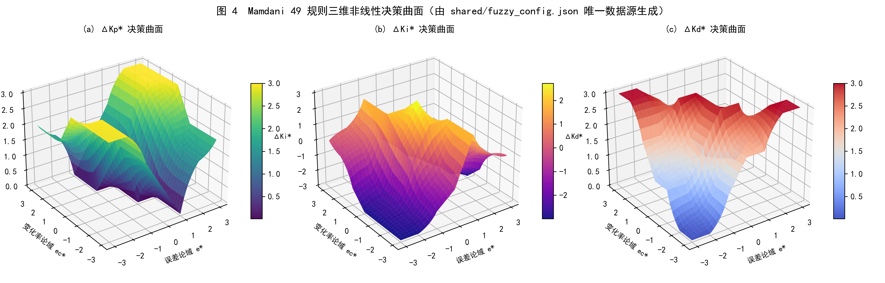
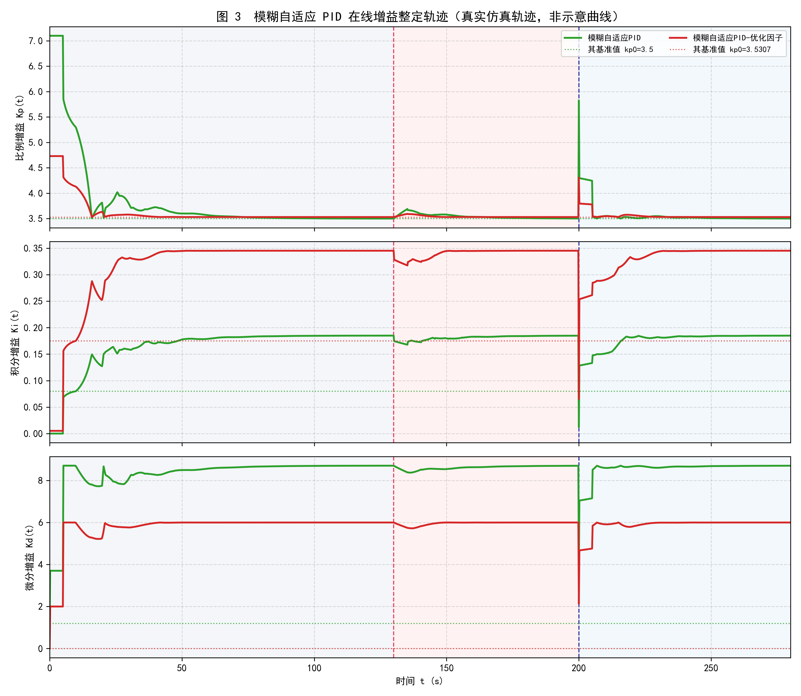
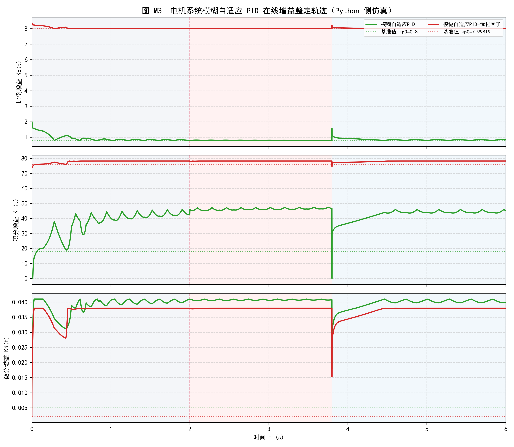

# 智能控制课程设计：模糊自适应 PID 的多场景全维度剖析 (Yclor_Contrl-Smartly-2026)


> **项目简介**：本仓库是针对**湘潭大学（XTU）自动化专业《智能控制》课程设计**打造的完整开源实现与教学研究库。内容涵盖**多场景模糊自适应 PID 控制（Fuzzy Adaptive PID）**的原理剖析、双环系统架构设计、**Python 与 MATLAB/Simulink 跨语言高保真一致性仿真**（单步偏差 $< 5 \times 10^{-8}$）、**三大工业物理场景建模**、**七项深度拓展实验（E1~E7）**，以及完整的**实验指导书、Visio 架构源文件与答辩 PPT 制作指导全案**。

---

## 📑 核心文档与资源快速导航

| 资源分类                       | 文件路径                                                                                | 内容说明                                                                                                  |
| :----------------------------- | :-------------------------------------------------------------------------------------- | :-------------------------------------------------------------------------------------------------------- |
| **🎤 答辩 PPT 指导书**   | [`PPT.md`](PPT.md)                                                                     | **21 页答辩 PPT 逐页制作与演讲指导书**（含完整公式变量释义、49 条规则表、三大场景工况表与答辩 Q&A） |
| **📊 答辩汇报课件**      | [`模糊自适应PID控制汇报.pptx`](模糊自适应PID控制汇报.pptx) / [`自拟.pptx`](自拟.pptx) | 课程设计答辩汇报演示文稿成品                                                                              |
| **📐 控制框图源文件**    | [`模糊自适应PID控制框架图.vsdx`](模糊自适应PID控制框架图.vsdx)                         | Microsoft Visio 绘制的模糊自适应 PID 控制系统矢量框图源文件                                               |
| **📘 学生实验指导书**    | [`实验指导书.md`](实验指导书.md)                                                       | 面向教学与实验复现的分步指导手册                                                                          |
| **📈 实验数据总报告**    | [`results/实验结果汇总.md`](results/实验结果汇总.md)                                   | 由自动化脚本根据仿真 CSV 实时渲染生成的全量量化指标汇总报告                                               |
| **⚙️ 唯一真值配置源**  | [`shared/fuzzy_config.json`](shared/fuzzy_config.json)                                 | 跨 Python / MATLAB /`.fis` 共享的模糊论域、隶属度、49 条规则表及三大场景参数唯一数据源                  |
| **🐍 Python 子项目说明** | [`python/README.md`](python/README.md)                                                 | 纯自研零阶 Sugeno 推理核、仿真引擎、参数寻优与绘图模块详细说明                                            |
| **🧮 MATLAB 子项目说明** | [`matlab/README.md`](matlab/README.md)                                                 | MATLAB 对照实现、`.fis` 自动生成、Simulink 自动建模与跨语言逐点校验说明                                 |

---

## 📖 故事的开始：为什么我们需要模糊自适应 PID？

在工业控制中，**经典 PID 控制**凭借结构简单、物理意义清晰的特性占据了 90% 以上的工业基础回路：

$$
u(t) = K_p e(t) + K_i \int_0^t e(\tau) d\tau + K_d \frac{de(t)}{dt}
$$

只要被控对象是线性的、参数定常的，一个经过精心整定的固定参数 PID 就能表现出近乎完美的性能。然而，真实的工业现场往往充满了**非线性与不确定性**：

* **工业电加热炉**：保温层老化或炉门开启导致热散失激增，且单向加热（$0\sim 100\%$）存在严重的**积分饱和（Windup）**与升降温非对称性；
* **直流伺服电机**：机械臂抓取重物或伸展时，**负载力矩 $T_L$ 与转子转动惯量 $J$ 可能瞬间成倍增加**；
* **双容串联液位过程**：上下游水箱容积惯性串联叠加管道纯滞后，反向降液时极易因上游存水滞后引发**二次下冲超调**。

**模糊自适应 PID (Fuzzy Adaptive PID)** 正是为了解决“定常参数无法适应变工况”这一痛点而生。它将人类熟练工程师的调参经验（Heuristics）固化为模糊规则，在系统运行过程中实时监测**跟踪误差 $e(t)$** 和**误差变化率 $ec(t)$**，毫秒级在线动态合成 PID 三项增益：

$$
K_p(t) = K_{p0} + k_{up} \cdot \Delta K_p^*(e, ec), \quad K_i(t) = K_{i0} + k_{ui} \cdot \Delta K_i^*(e, ec), \quad K_d(t) = K_{d0} + k_{ud} \cdot \Delta K_d^*(e, ec)
$$

* **$K_{p0}, K_{i0}, K_{d0}$**：预先整定的**初始基准 PID 参数**（提供稳态控制底座）；
* **$\Delta K_p^*, \Delta K_i^*, \Delta K_d^* \in [-3, +3]$**：模糊推理机在线推理输出的**归一化论域修正量**；
* **$k_{up}, k_{ui}, k_{ud}$**：将无量纲修正量映射为物理增益增量的**输出比例缩放因子**。

---

## 🏗️ 第一幕：系统架构与打破黑盒 —— 模糊推理机是如何工作的？

### 1. 总体双环控制架构（外环模糊自整定 + 内环抗饱和 PID）

本系统采用**“上层模糊推理在线调参外环 + 下层带条件积分抗饱和的动态 PID 内环”**双层解耦架构：


1. **上层 —— 模糊自适应在线调参外环**：采集实时误差 $e(t)$ 与差分导数 $ec(t)$，经输入量化因子 $k_e, k_{ec}$ 限幅映射至标准论域 $[-3, +3]$，通过 7 子集模糊化、49 条专家规则激活推理与加权重心清晰化，实时输出物理增益修正量并叠加安全下界保护；
2. **下层 —— 条件抗积分饱和（Conditional Integration）PID 内环**：采用增量式积分 $\Delta I(k) = K_i(k) e(k) \Delta t$ 防止 $K_i(t)$ 时变引发控制量跳变；当执行器达到物理限幅 $[u_{\min}, u_{\max}]$ 且误差继续同向恶化时自动冻结积分，从架构底层根除积分饱和。

### 2. 经验的量化：混合隶属度函数 (Membership Functions)

我们将归一化输入 $e^*, ec^*$ 与输出 $\Delta K^*$ 划分为 7 个模糊语言子集：`NB(负大), NM(负中), NS(负小), ZO(零), PS(正小), PM(正中), PB(正大)`。中间 5 个子集采用高灵敏度**对称三角形函数 (`trimf`)**，两端极值采用**平顶梯形函数 (`trapmf`)** 并做斜坡内延设计，实现大误差工况下的“极值规则前置介入”。


### 3. 规则激活、重心推理与三维非线性决策曲面

为了彻底打破“黑盒”，我们提取了系统在典型工况点（$e^*=2.1, ec^*=-1.3$）的推理切片（下图 F2）。采用**代数积 T-范数**计算前件联合激活强度 $\alpha_{ij} = \mu_e(i) \cdot \mu_{ec}(j)$，激活的规则单元共同投票，再经**零阶 Sugeno 加权重心法**解算出精确修正量，在整个论域上构成平滑连续的三维增益决策曲面（下图 4）。




---

## 🌐 第二幕：三大工业物理场景闭环回路总览

为了验证算法在不同物理域与时间尺度下的泛化性能，我们构建了跨**热工慢过程（$\text{s}$ 级）**、**机电快过程（$\text{ms}$ 级）**与**流体双容过程（十秒级）**的三大标准测试场景，并统一设置 **5 组严格对照控制器**（`PID-无抗饱和`、`PID-抗饱和`、`PID-ITAE最优`、`模糊自适应PID`、`模糊自适应PID-优化因子`）：


---

## 🔥 第三幕：场景一（工业电加热炉 FOPDT）与 E7 参数突变大考

### 1. 标称工况下的初步较量

* **被控对象**：一阶惯性纯滞后系统 (FOPDT) $G_1(s) = \frac{1.5}{25s + 1}e^{-5s}$，加热功率单向限幅 $u \in [0, 100]\%$。
* **预设工况**：$t=0\,\text{s}$ 由室温 $20^\circ\text{C}$ 阶跃升温至 $100^\circ\text{C}$；$t=110\sim 130\,\text{s}$ 注入 $-25\%$ 强冷水扰动；$t=190\,\text{s}$ 反向阶跃降温至 $70^\circ\text{C}$。




| 控制器方案                       | 上升时间$t_r/\text{s}$ | 升温超调$\sigma_1/\%$ | 调节时间$t_{s1}/\text{s}$ | 扰动跌落$/^\circ\text{C}$ | 降温超调$\sigma_2/\%$ |    全程 ITAE    |   控制量 TV   |
| :------------------------------- | :----------------------: | :---------------------: | :-------------------------: | :-------------------------: | :---------------------: | :--------------: | :-----------: |
| **PID-无抗饱和**           |          15.00          |         16.67%         |            101.0            |            3.50            |         25.57%         |     113,543     |      270      |
| **PID-抗饱和**             |          15.20          |     **0.00%**     |            117.4            |            5.25            |          9.92%          |     126,057     |      292      |
| **PID-ITAE最优**           |          15.20          |     **0.00%**     |            36.8            |            3.78            |         11.65%         |      64,522      |      176      |
| **模糊自适应PID（默认）**  |          24.40          |     **0.00%**     |            59.6            |       **3.53**       |     **4.32%**     |      75,260      |      269      |
| **模糊自适应PID-优化因子** |          15.40          |          0.16%          |       **35.8**       |            3.70            |         11.26%         | **63,585** | **174** |

> **关键发现**：在相同初始参数 $(3.5, 0.08, 1.2)$ 下，模糊自适应相比 `PID-抗饱和` 将调节时间缩短 **49.2%**，降温超调降低 **56.5%**，ITAE 改善 **40.3%**；而在标称线性工况下，相比数值寻优到极限的 `PID-ITAE最优`，`模糊优化因子` 仅带来约 **1.5%** 的微小提升。那么，**为什么还要付出计算代价去运行 49 条模糊规则？**

### 2. E7 核心实验：对象参数在线跳变鲁棒性测试（自适应的真正价值）

在 $t=80\,\text{s}$ 系统处于稳态时，我们**人为将加热炉的静态增益 $K$ 瞬间翻倍（从 $1.5$ 突变为 $3.0$）**，模拟极端工况下的对象异变；随后在 $t=160\,\text{s}$ 恢复，期间**控制器基础参数冻结、不允许任何重调**。


* **PID-抗饱和（橙线）**：由于对象增益翻倍，原本合适的固定 $K_p$ 变得严重过大，系统出现高达 **21.76%** 的剧烈超调！
* **PID-ITAE最优（紫线）**：标称最优参数在模型失配后变得激进，依然产生了 **8.02%** 的跳变超调。
* **模糊自适应PID（绿线/红线）**：推理机敏锐捕捉到误差反向激增，**瞬间在线大幅下调 $K_p$ 并拉高 $K_d$ 阻尼**（见上图底部增益轨迹），以退为进，将跳变超调死死压制在 **6.18%**（比抗饱和 PID 降低 **71.6%**，比最优固定 PID 降低 **23.0%**）！

> **核心结论 1**：模糊自适应 PID 的真正价值**不在于标称线性工况下超越完美整定的固定 PID**，而在于**当被控对象发生漂移、失配或突变时，它能像有经验的工程师一样在线自救，展现出强大的鲁棒生命力**。

---

## ⚙️ 第四幕：跨物理域泛化证明（机电伺服与双容液位）

核心 49 条模糊规则矩阵**无需任何修改**，仅根据物理量纲配置缩放因子，即可无缝迁移至完全不同的物理场景：

### 1. 场景二：直流伺服电机速度控制（机电耦合二阶系统）

* **被控对象**：$L_a \frac{di_a}{dt} = u - R_a i_a - K_e \omega,\; J(t) \frac{d\omega}{dt} = K_t i_a - B\omega - T_L(t)$，驱动电压限幅 $u \in [-24, +24]\,\text{V}$。
* **预设工况**：$t=0\,\text{s}$ 空载阶跃起动 $0 \to 100\,\text{rad/s}$；$t=2.0\sim 3.2\,\text{s}$ 突加负载力矩 $T_L=0.25\,\text{N}\cdot\text{m}$；$t=3.8\,\text{s}$ **转子转动惯量 $J$ 瞬间突增至 $2.5$ 倍**并同时阶跃提速至 $130\,\text{rad/s}$。




* **核心表现**：在同基准对比下，模糊自适应将 $2.5$ 倍变惯量提速超调从 $14.28\%$ 降至 **$11.28\%$**（降低 $21\%$）；`模糊优化因子` 实现了 **$0.00\%$ 绝对零超调起动**，并将控制电压总变差 TV 从 $97.8$ 降至 **$84.0$（降低 14.1%）**，驱动器发热与动作频度更低。

### 2. 场景三：双容串联液位过程（二阶过阻尼大滞后 SOPDT）

* **被控对象**：上下游串联水箱 $G_3(s) = \frac{0.96}{(30s+1)(15s+1)}e^{-3s}$，进水阀开度 $u \in [0, 100]\%$。
* **预设工况**：$t=0\,\text{s}$ 升液阶跃 $20\% \to 60\%$；$t=120\sim 150\,\text{s}$ 注入 $+15\%$ 副管进液冲击；$t=230\,\text{s}$ **反向降液阶跃 $60\% \to 40\%$**。


* **核心表现**：
  1. **稳态精度提升 54.8%**：升液稳态余差由固定 PID 的 $+3.744\%$ 降至 **$+1.694\%$**；
  2. **抗扰恢复加快 20.1%**：副管进液冲击后的恢复时间由 $109.5\,\text{s}$ 缩短至 **$87.5\,\text{s}$**；
  3. **100% 消除反向降液二次超调**：在 $60\% \to 40\%$ 降液阶段，固定 PID 因上游水箱存水滞后与积分累积产生了 **$4.29\%$ 的下冲超调**，而模糊自适应 PID 精准削弱积分并增强阻尼，实现了 **$0.00\%$ 无超调平滑降落**！

---

## 🔬 第五幕：七大深度拓展实验全景（E1 ~ E7）

除了三大主场景外，我们在 [`python/experiments.py`](python/experiments.py) 中设计了 7 组直击工程痛点的定量对照实验（全部图表位于 [`results/figures/`](results/figures/)）：

|      实验编号      | 实验名称                                | 核心探究问题与实验结论                                                                                                                                   | 对应结果图表                                                                                                                                               |
| :----------------: | :-------------------------------------- | :------------------------------------------------------------------------------------------------------------------------------------------------------- | :--------------------------------------------------------------------------------------------------------------------------------------------------------- |
| **E1 / E1M** | **蒙特卡洛参数摄动鲁棒性**        | 当对象参数$(K, T, \tau)$ 或电机参数在 $\pm 30\%$ 内随机摄动（300 组）时，模糊控制显著收窄超调分布长尾，最坏超调大幅低于固定 PID。                    | [`E1_monte_carlo_robustness.png`](results/figures/E1_monte_carlo_robustness.png)[`E1M_motor_monte_carlo.png`](results/figures/E1M_motor_monte_carlo.png) |
| **E2 / E2M** | **数字控制采样周期敏感性**        | 考察控制器采样周期$T_s$ 增大（零阶保持离散化）对闭环稳定性的影响，量化数字嵌入式落地的最大允许采样步长边界。                                           | [`E2_control_period.png`](results/figures/E2_control_period.png)[`E2M_motor_control_period.png`](results/figures/E2M_motor_control_period.png)           |
| **E3 / E3M** | **量测噪声与微分低通滤波**        | 揭示传感器高斯白噪声下理想微分使控制量总变差$\text{TV}(u)$ 激增近 10 倍的现象，证实**一阶低通滤波微分**对保护执行机构的必要性。                  | [`E3_noise_and_filter.png`](results/figures/E3_noise_and_filter.png)[`E3M_motor_noise_filter.png`](results/figures/E3M_motor_noise_filter.png)           |
|    **E4**    | **模糊缩放因子敏感性扫描**        | 对输入/输出缩放因子进行一维与二维网格扫描，证明“**基准参数是底座，模糊调节是微调**”，合理的缩放量程是避免规则饱和的关键。                        | [`E4_scaling_sensitivity.png`](results/figures/E4_scaling_sensitivity.png)                                                                                |
|    **E5**    | **宽范围多工作点阶梯跟踪**        | 在$20 \to 55 \to 85 \to 115 \to 70 \to 40^\circ\text{C}$ 连续五段阶梯跟踪中，模糊控制全段超调降低最高达 **65%**。                                | [`E5_staircase_tracking.png`](results/figures/E5_staircase_tracking.png)                                                                                  |
|    **E6**    | **模型失配收益边界（Crossover）** | 定量描绘“何时该用模糊 PID”：当对象变得**更难控**（滞后 $\tau$ 增大、时间常数 $T$ 减小、增益 $K$ 增大）时，模糊自适应全面反超最优固定 PID。 | [`E6_mismatch_crossover.png`](results/figures/E6_mismatch_crossover.png)                                                                                  |
|    **E7**    | **运行中对象参数突变自救**        | 稳态运行中途炉体增益$K$ 瞬间翻倍，验证控制器在不重调参数条件下的**在线抑制超调与自救能力**。                                                     | [`E7_param_jump.png`](results/figures/E7_param_jump.png)                                                                                                  |

---

## 💡 第六幕：工程反思与总结

通过这套完整的仿真分析，我们提炼出关于智能控制的三大工程准则：

1. **没有免费的午餐（No Free Lunch）**：模糊自适应显著提升了复杂变工况下的鲁棒性与防超调能力，代价是更高的计算开销及对微分量测噪声的敏感性（需配合一阶低通滤波微分）。
2. **基准参数与抗饱和是底座**：模糊推理机的输出论域为 $[-3, +3]$，其本质是在基准参数 $(K_{p0}, K_{i0}, K_{d0})$ 附近做在线增益调度，**良好的基准整定与条件抗积分饱和（Anti-Windup）不可或缺**。
3. **因地制宜选型**：若系统线性、定常、工作点单一，优先选用经典抗饱和 PID；若面对**大滞后、强耦合、变负荷或参数频繁漂移跳变**的复杂工业过程，模糊自适应 PID 才是真正发挥威力的利器。

---

## 🚀 快速开始：一键重现全套实验与图表

### 1. 环境准备

* **Python 环境**：Python $\ge 3.10$
  ```bash
  pip install numpy scipy matplotlib
  ```
* **MATLAB 环境（可选，用于对照验证与 Simulink 仿真）**：MATLAB R2019b 及以上版本

### 2. Python 一键运行（在仓库根目录执行）

```bash
# 完整模式：依次执行单元测试 -> 参数寻优 -> 三大场景仿真 -> E1~E7 拓展实验 -> 模糊解剖与报告生成（约 8~12 分钟）
python python/run_all.py

# 快速模式：跳过耗时的蒙特卡洛与网格扫描，快速生成核心图表与报告（约 1~2 分钟）
python python/run_all.py --quick
```

也可以单独运行各个功能脚本：

```bash
python python/test_fuzzy_core.py               # 1. 运行 21 项核心算法单元测试
python python/figure_architecture_diagrams.py  # 2. 生成总体双环架构图(A1)与三大场景回路图(A2)
python python/figure_fuzzy_anatomy.py          # 3. 生成隶属度函数(F1)与模糊推理切片解剖图(F2)
python python/temperature_simulation.py        # 4. 场景一：工业电加热炉仿真与出图
python python/motor_simulation.py              # 5. 场景二：直流伺服电机仿真与出图
python python/level_simulation.py              # 6. 场景三：双容串联液位过程仿真与出图
python python/experiments.py                   # 7. 拓展实验 E1 ~ E7
python python/make_report.py                   # 8. 自动汇总 CSV 数据生成 results/实验结果汇总.md
```

### 3. MATLAB 与跨语言一致性核查

在 MATLAB 命令窗口中进入 `matlab/` 目录：

```matlab
cd matlab
generate_fis            % 自动由 shared/fuzzy_config.json 生成并校验 fuzzy_pid.fis
verify_consistency      % 导出 61x61 推理网格供跨语言逐点比对
thermal_simulation      % 场景一 MATLAB 仿真并与 Python 轨迹逐点核查
motor_simulation        % 场景二 MATLAB 直流伺服电机主实验
experiments_motor       % 电机侧拓展实验 E1M ~ E3M
build_simulink_model    % 代码自动搭建 Simulink 闭环仿真模型
```

---

## 📂 仓库目录全貌

```text
Yclor_Contrl-Smartly-2026/
├── README.md                                  ★ 项目主页：原理剖析、多场景实验故事与快速导航
├── PPT.md                                     ★ 21页答辩PPT制作与演讲指导书（含完整公式/规则表/工况表）
├── 实验指导书.md                               学生实验分步指导手册
├── 模糊自适应PID控制汇报.pptx / 自拟.pptx        课程设计答辩汇报 PPT 课件
├── 模糊自适应PID控制框架图.vsdx                  Visio 绘制的系统控制框图矢量源文件
├── shared/
│   └── fuzzy_config.json                      ★ 唯一真值数据源：模糊论域、隶属度、49条规则与三场景参数
├── python/
│   ├── README.md                              Python 子项目技术文档
│   ├── run_all.py                             ★ 全流程一键运行入口脚本
│   ├── fuzzy_config.py / fuzzy_pid.py         配置加载器、零阶 Sugeno 推理机与模糊自适应 PID 核心类
│   ├── plants.py / simcore.py                 三大物理被控对象模型与多速率闭环仿真引擎
│   ├── controllers.py / tuning.py             5组标准对照控制器装配与 Nelder-Mead ITAE 数值寻优
│   ├── metrics.py                             时域动态指标、积分性能指标(IAE/ISE/ITAE)与总变差(TV)计算
│   ├── temperature_simulation.py              场景一（工业电加热炉）仿真与可视化
│   ├── motor_simulation.py                    场景二（直流伺服电机）仿真与可视化
│   ├── level_simulation.py                    场景三（双容串联液位）仿真与可视化
│   ├── experiments.py                         深度拓展实验 E1 ~ E7 实现
│   ├── figure_architecture_diagrams.py        总体架构图(A1)与三大场景控制回路图(A2)绘制脚本
│   ├── figure_fuzzy_anatomy.py                隶属度函数(F1)与模糊推理解剖图(F2)绘制脚本
│   ├── test_fuzzy_core.py / verify_consistency.py  21项单元测试与跨语言一致性核查
│   ├── make_report.py                         自动化 Markdown 报告生成器
│   └── *.png                                  场景主图、架构图与模糊机理剖析高清配图
├── matlab/
│   ├── README.md                              MATLAB 子项目技术文档
│   ├── fuzzy_config.m / generate_fis.m        配置读取与 fuzzy_pid.fis 自动生成校验
│   ├── fuzzy_pid_controller.m / fixed_pid_controller.m  MATLAB 侧控制器类实现
│   ├── run_thermal.m / run_motor.m            加热炉与直流电机仿真内核
│   ├── thermal_simulation.m / motor_simulation.m  主仿真脚本与跨语言轨迹对比
│   ├── experiments_motor.m                    电机侧拓展实验 E1M ~ E3M
│   ├── build_simulink_model.m                 Simulink 模型自动搭建脚本
│   └── fuzzy_pid.fis                          标准零阶 Sugeno 模糊推理系统文件
└── results/
    ├── 实验结果汇总.md                         ★ 自动生成的全量量化实验报告
    ├── tuned_params.json                      数值寻优最优参数存档
    ├── *.csv                                  所有实验的原始时序数据与性能指标统计表
    ├── figures/                               拓展实验 E1~E7 及跨语言对比图表 (12张)
    └── logs/                                  Python 与 MATLAB 运行日志存档
```

---

## 👥 课程设计小组成员与分工

|    序号    |     成员姓名     |            角色定位            | 具体负责工作内容                                                                                                                                              |
| :---------: | :--------------: | :-----------------------------: | :------------------------------------------------------------------------------------------------------------------------------------------------------------ |
| **1** | **尹健泷** | **项目负责人 / 核心开发** | 独立完成 PPT 制作、Python/MATLAB 全套算法代码编写、模糊推理引擎构建、三大物理场景（加热炉/电机/双容液位）数学建模与仿真实现、系统架构图绘制及实验数据分析汇总 |
| **2** | **杨嘉隆** |            小组成员            | 负责相关文献调研与背景资料收集                                                                                                                                |
| **3** | **刘思明** |            小组成员            | 负责相关文献调研与背景资料收集                                                                                                                                |
| **4** | **刘智康** |            小组成员            | 负责相关文献调研与背景资料收集                                                                                                                                |
| **5** | **郭　振** |            小组成员            | 负责相关文献调研与背景资料收集                                                                                                                                |

---

*(本项目基于 Python 3.13 与 MATLAB R2024a 验证，Python、MATLAB 脚本与 `.fis` 推理核在单步级别的一致性偏差 $< 5 \times 10^{-8}$)*
